<div align="center">
  <h1>Sunta Engine 3D</h1>
  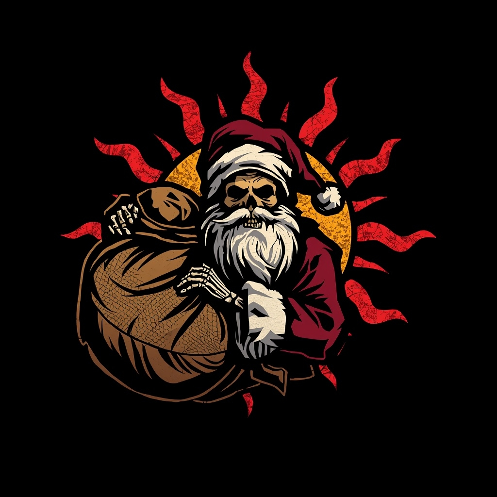
  <p align="center">
    <a href="https://github.com/LightWeightBrah/Sunta-3D-Game-Engine/actions/workflows/build.yml"></a>
    <a href="https://github.com/LightWeightBrah/Sunta-3D-Game-Engine/releases"></a>
    <a href="LICENSE"></a>
  </p>

  <p><i>A custom 3D game engine in C++ and OpenGL with a built-in editor, Lua scripting and one-click game builds.</i></p>
</div>

---

## Quick Start
1. Download the engine for your system from [Releases](https://github.com/LightWeightBrah/Sunta-3D-Game-Engine/releases) (a `.zip` for Windows, a `.tar.gz` for Linux and macOS) and unpack the whole folder.
2. Start `SuntaEditor`.
3. In the launcher click **Open Sample Project**, or create a project of your own.
4. Press the play button in the toolbar to run the scene, or choose `Project > Project Settings > Save and Build Game` to make a game you can send to players.

Do you want to compile the engine yourself? See [Building the Engine](#building-the-engine).

**Documentation** (in [`docs/`](docs/index.md), ready for GitHub Pages): [Getting started](docs/getting-started.md),
a step-by-step [tutorial for a small souls-like](docs/tutorial-soulslike.md), [Scripting](docs/scripting.md),
the [Components](docs/components.md) and [Scripting reference](docs/scripting-reference.md) (both generated from the
engine's code by `Tools/Docs/`), and [Testing a game automatically](docs/testing.md).

---

## Showcase

<div align="center">
  <h3>Editor</h3>
  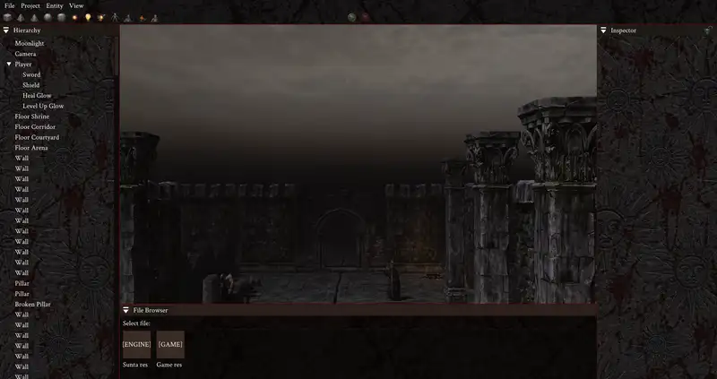
  <p><i>A dockable workspace made with ImGui: a hierarchy of entities, an inspector generated from the C++ components, a file browser and transform gizmos for moving, rotating and scaling objects.</i></p>
</div>

<br />

<div align="center">
  <h3>Play Mode and Lua Scripting</h3>
  
  <p><i>Press play to run the scene in the editor. Gameplay is written in Lua, and a script reloads as soon as you save it, so you can change the game while it runs.</i></p>
</div>

<br />

<div align="center">
  <h3>Lighting and Materials</h3>
  
  <p><i>Phong lighting with directional, point and spot lights. Specular maps decide how shiny each pixel of a surface is, so metal and matte parts can share one material.</i></p>
</div>

<br />

<div align="center">
  <h3>Physics</h3>
  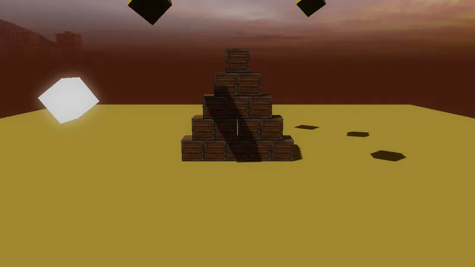
  <p><i>Rigid bodies with mass, friction, bounce and spin: oriented boxes collide (SAT) and come to rest stacked; collision layers, triggers that report enter, stay and exit, and raycasts. The scene is <code>Projects/Showcase</code> (made by its own script).</i></p>
</div>

<br />

<div align="center">
  <h3>Skeletal Animation</h3>
  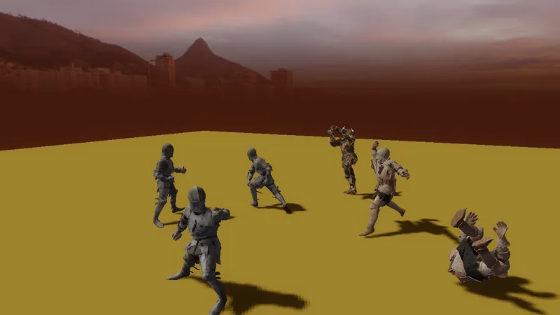
  <p><i>Skinned glTF and FBX models with their clips: bones driven on the CPU, smooth cross-fades between clips, an upper-body layer (blocking while walking), held items on bones and procedural aim of the strikes. The scene is <code>Projects/Showcase</code>.</i></p>
</div>

<br />

<div align="center">
  <h3>Game Camera</h3>
  
  <p><i>Place a camera in the scene or create one from the current editor view. The editor shows what it sees, and Play mode uses it.</i></p>
</div>

<br />

<div align="center">
  <h3>Project Launcher and One-Click Build</h3>
  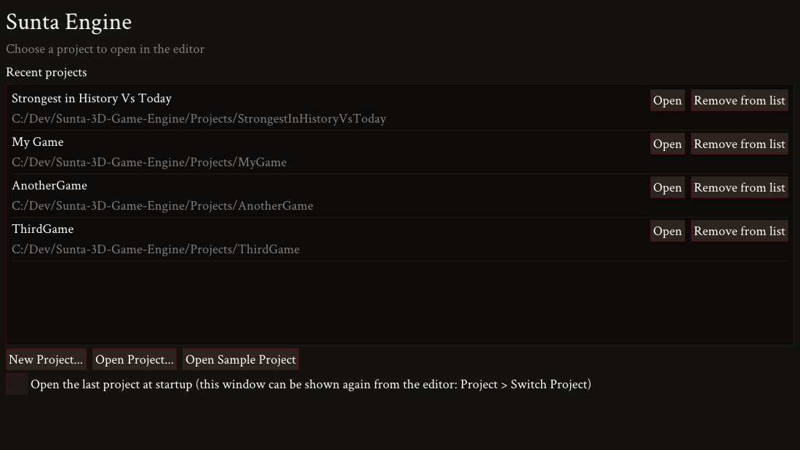
  <p><i>The launcher lists your recent projects and the sample project. When the game is ready, one click packages it into a folder for players, no compiler needed.</i></p>
</div>

<br />

<div align="center">
  <h3>Sample Game: Strongest in History Vs Today</h3>
  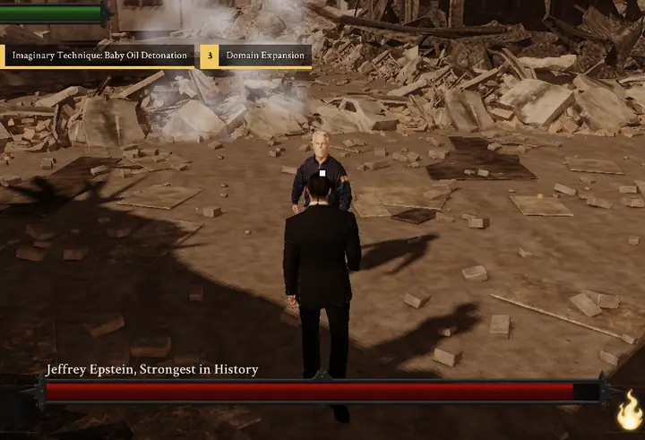
  <p><i>A parody boss fight made only from the engine's general components, data of the scene and Lua: a fist fight with
  combos, blocks, parries and rolls, effects on every swing and hit, and a boss in four phases.</i></p>
  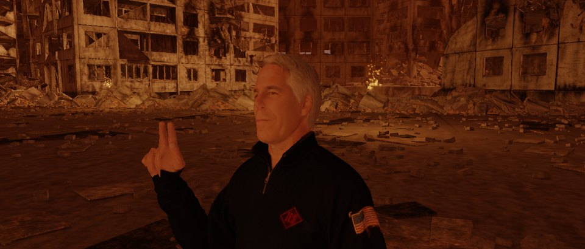
  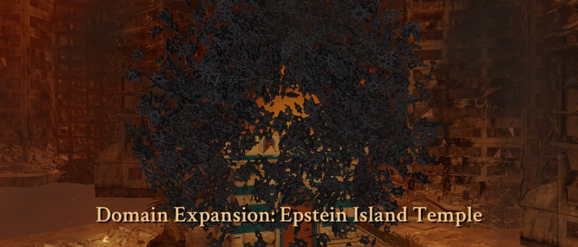
  <p><i>The boss's domain opens with a staged sequence of cutscenes timed to the soundtrack: the sky turns, a temple rises
  out of the ground and thousands of stars fly out of its dome.</i></p>
  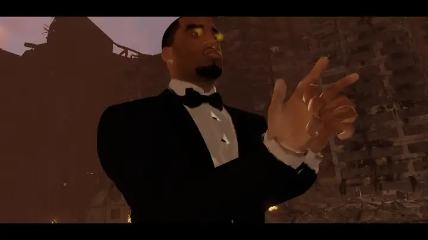
  <p><i>The player's own domain, staged like the film: a close-up of the hand sign, a whirl of liquid made of
  effect shapes, the floor of the arena covered with oil and two waves running in from both sides of the boss.</i></p>
  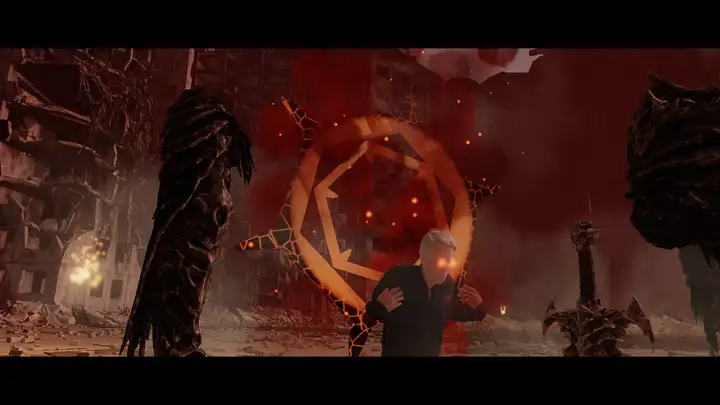
  <p><i>At zero health of his last stand the boss doesn't fall: a rift drops his armor and his sword, the pieces fly
  onto him in two beats and the engine puts his armored model on in their place (a model swapped at runtime, the
  same skeleton and clip names), then he fights with a great sword in two more phases.</i></p>
  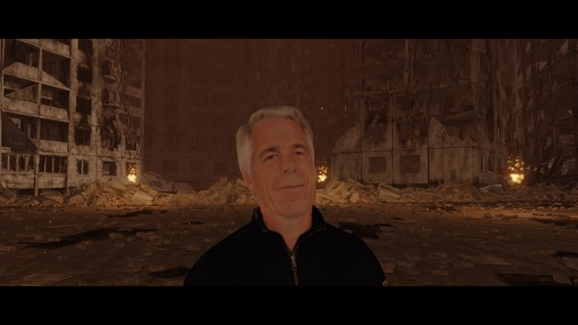
  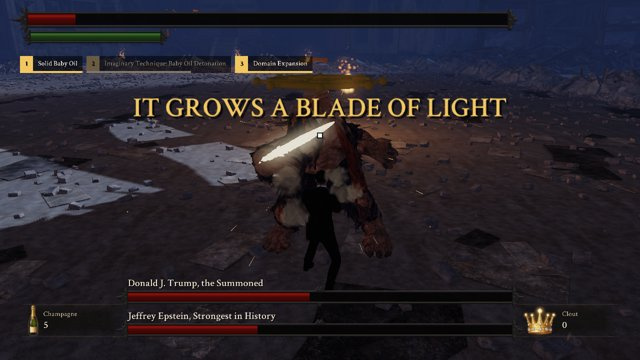
  <p><i>Faces act in the close shots: the boss's smile is a morph target of his head (the engine's model expression),
  made by the character generator from the corners of his mouth. His summon adapts to what hurts it - the wheel over
  its head turns an eighth each time - rushes through a player who keeps away and grows a blade of light at half health.</i></p>
  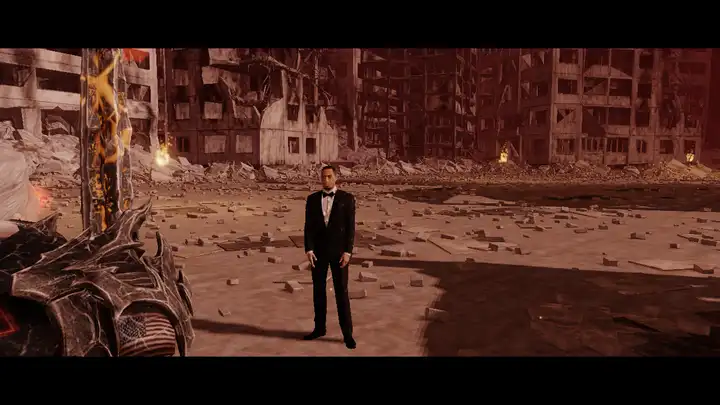
  <p><i>The player's answer to the armor, shot by shot from the user's scenario: a bottle of baby oil gathers beside his
  open hand, bursts as he makes the sign, the oil crystallizes into armor on him and a sword of frozen oil comes out of
  a burst - rendered with the engine's see-through crystal material: what is behind it shows through, bent by its
  surface (the scene is copied after the solid parts and the crystal ones sample it).</i></p>
  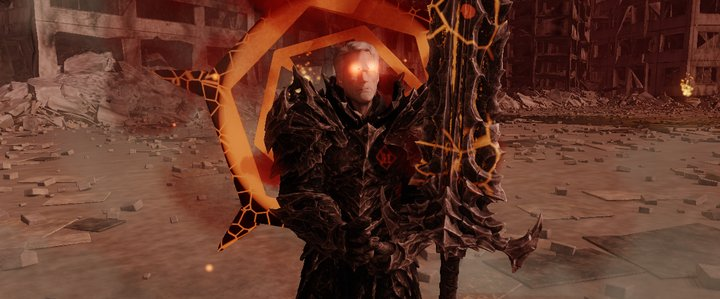
  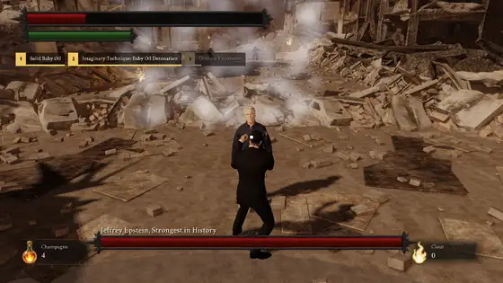
  <p><i>A hexagonal seal burns behind the boss from the summoning on. The player can jump, kick from the air or plunge
  both fists into the ground with a shockwave (general Jump and Jump Attack actions of the engine).</i></p>
</div>

---

## Features

**Editor**
* Dockable windows: hierarchy, inspector, file browser, project settings.
* Transform gizmos, a free-fly editor camera and a game camera that can be created from the current view.
* Play mode with Lua hot-reload.
* Project launcher with recent projects and a sample project.
* Project settings: game name, start scene, window size, fullscreen, vsync and game icon.
* Tracking of unsaved changes with the usual shortcuts (`Ctrl+N`, `Ctrl+O`, `Ctrl+S`, `Ctrl+Shift+S`).
* **Build Game:** packages a project into a folder for players. The game icon is made from one PNG for the system you build on. The build also works without a window: `SuntaEditor --build-game <project folder>`.

**Souls-like gameplay** (general components, a game's names and numbers are data of its scene)
* **Character Actions:** light combos, heavy attacks, running, leaping and riposte attacks, each attack with its own hit
  window, damage and cancel point; rolls and backsteps with invulnerability; jumps with attacks from the air and a
  plunge with its own shockwave; blocking, parrying, poise, hyper armor and stamina; staggers that can be rolled out of
  and a short immunity to a volley of projectiles.
* **Strike Aim:** while a character attacks, its spine bends and turns towards the enemy's face or chest (an aim
  offset), so animations made for an opponent of another height still land where they look like they land.
* **Enemies and bosses:** a state machine of enemies extended from Lua, lock-on with switching, a fog gate into the
  arena, boss phases with health floors, a summon, spells and projectiles.
* **Healing flask, currency, bonfires and level up**, all with display names of the game's own choosing.
* **Effects:** instanced particles (glow, flame, smoke, sparks, rings) with drag and three-colour lifetimes, effect
  shapes (rings, slash arcs, flashes) composed into named effects, swarms of thousands of meshes, weapon trails, bloom,
  hit stop, camera shake and an impact frame.
* **Cutscenes:** sequences of camera shots and character moves, skippable, chained into staged moments; a shot started
  during another cuts in on it, and the HUD stays away between the shots of one scene. Faces can act in them: a
  model's first morph target is its expression (`model.expression`, e.g. a smile), and a character can be outlined in
  light (`model.rimGlow`) for the moment a technique is called. *View > Show Cutscene Camera Paths* draws every shot's
  camera points and the curve its camera flies along in the editor; a quick-time event (pressing a key quickly, a
  button on the screen popping with each press) is a cutscene setting.
* **Knockback:** a blow can throw the one it staggers back along the ground - sliding back on the feet, slowing
  down in a trail of dust, standing up clean (`hitbox.knockback`, `characterActions:knockBack()`).
* **Transformations at runtime:** a script can put another model on a character (same skeleton, same clip names), switch
  its weapons' hitboxes, change the timing of its attacks and the effects of its swings - a boss that takes up armor and
  a sword in the middle of the fight.
* **Follow camera** that rises over low obstacles behind the player instead of coming up to their head, and goes
  through unseen walls.

**Automated testing**
* `SUNTA_INPUT_SCRIPT=<file>` plays keyboard and mouse input from a text file (taps, holds, mouse looks, saved frames)
  and a test bot locks on, approaches and fights an enemy, so a test really plays the game.
* `SUNTA_COMBAT_LOG=1` writes every swing to a CSV: whether it landed and at which height of the target's body;
  `SUNTA_COMBAT_TRACE=1` adds where each fist, foot or weapon is in every frame of an attack.
* `SUNTA_FIXED_DT=0.033` advances the game by fixed steps for smooth recordings; `SUNTA_MUTE=1` silences test runs.

**Engine**
* **Rendering:** wrappers for OpenGL objects (VAO, VBO, EBO, textures, shaders), Phong lighting with directional, point and spot lights, shadows, fog, specular and emissive maps, materials (a *Crystal* setting renders clear crystal or ice: Fresnel edges, light caught inside, glints; set by a material named `*crystal*`) and a debug renderer for colliders.
* **ECS:** a data-oriented entity component system. Components: Tag, Transform, Script, Mesh, Model, Animator, Directional / Point / Spot Light, Box Collider, Physics Body and Camera.
* **Physics:** collisions (Separating Axis Theorem), collision layers, triggers (enter, stay, exit) and raycasts.
* **Audio:** spatial sounds heard from the game camera, looping Audio Sources, character sounds played by the fight (swings, hits, blocks, parries, footsteps), battle music with fades; `.wav`, `.ogg`, `.flac` and `.mp3`.
* **Scripting:** gameplay in Lua ([sol2](https://github.com/ThePhD/sol2)) with access to transforms, physics bodies and input.
* **Assets:** OBJ, FBX, glTF and Collada models through Assimp. Scenes are JSON files, and resource paths are virtual (`@engine/...`, `@game/...`), so projects can be moved between computers.
* **Platforms:** Windows, Linux and macOS, built by CI on every commit.
* Also: a resource manager, an input manager, an event bus, dirty-flag transform updates and a logger that writes to a file.

---

## Tech Stack
* [**GLFW**](https://www.glfw.org/) - window and context management.
* [**GLAD**](https://glad.dav1d.de/) - OpenGL function loading.
* [**GLM**](https://github.com/g-truc/glm) - linear algebra and mathematics.
* [**ImGui**](https://github.com/ocornut/imgui) - editor interface (docking and viewports).
* [**ImGuizmo**](https://github.com/CedricGuillemet/ImGuizmo) - transform gizmos in the editor.
* [**Assimp**](https://www.assimp.org/) - 3D model and animation loading.
* [**stb_image**](https://github.com/nothings/stb) - texture and image loading.
* [**miniaudio**](https://github.com/mackron/miniaudio) and [**stb_vorbis**](https://github.com/nothings/stb) - sound playback and `.ogg` decoding.
* [**pl_mpeg**](https://github.com/phoboslab/pl_mpeg) - MPEG-1 video for cutscenes.
* [**Lua**](https://www.lua.org/) and [**sol2**](https://github.com/ThePhD/sol2) - gameplay scripting.
* [**nlohmann/json**](https://github.com/nlohmann/json) - scene and config files.
* [**nativefiledialog-extended**](https://github.com/btzy/nativefiledialog-extended) - native file and folder dialogs.

---

## Lines of Code
How big the engine and each game made with it are, counted automatically:

<!-- LINES-OF-CODE:START -->

| Part | Lines of code | Files | Languages |
|---|---:|---:|---|
| Engine core (`Sunta/src`, without the editor) | 34,747 | 324 | C++ 34,747 |
| Editor (`Sunta/src/Sunta/Editor`, `Apps/Editor`) | 6,669 | 63 | C++ 6,669 |
| Game runtime (`Apps/Runtime`) | 35 | 1 | C++ 35 |
| Shaders and engine scripts (`Sunta/res`) | 1,225 | 19 | GLSL 1,181, Lua 44 |
| Build (CMake, `cmake/`) | 252 | 5 | CMake 252 |
| Tools (`Tools/`: asset generators, tests, docs) | 6,519 | 39 | Python 6,488, JavaScript 31 |
| **Engine in all** | **49,447** | **451** | |
| Game: [`StrongestInHistoryVsToday`](Projects/StrongestInHistoryVsToday) | 6,786 | 11 | Python 3,590, Lua 3,196 |
| Game: [`Showcase`](Projects/Showcase) | 98 | 2 | Python 88, Lua 10 |
| Game: [`Scrap Souls`](Projects/ScrapSouls) | 60 | 3 | Lua 45, GLSL 15 |
| **Games in all** | **6,944** | **16** | |
| **Everything** | **56,391** | **467** | |

Non-empty lines of the files tracked by git, without third-party code (`Dependencies/`) and generated files (scenes, models). Counted by [`Tools/count_lines.py`](Tools/count_lines.py) on every push to main.

<!-- LINES-OF-CODE:END -->

---

## Building the Engine

You choose only the system and the build type: **Release** (fast, use it for playing and testing) or **Debug** (slow, for debugging). Every block below is meant to be copied as it is.

**Requirements:** CMake 3.21+, Ninja and a C++17 compiler. Third-party libraries are in `Dependencies/`.

```bash
git clone https://github.com/LightWeightBrah/Sunta-3D-Game-Engine.git
cd Sunta-3D-Game-Engine
```

### Windows
Install Visual Studio 2022 with the "Desktop development with C++" workload. Then open **Developer PowerShell for VS 2022** (or "x64 Native Tools Command Prompt for VS 2022"), go to the repository folder and run:

Release:
```bat
cmake --preset x64-Release
cmake --build --preset x64-Release
bin\Release-Windows-AMD64\SuntaEditor.exe
```
Debug:
```bat
cmake --preset x64-Debug
cmake --build --preset x64-Debug
bin\Debug-Windows-AMD64\SuntaEditor.exe
```
In Visual Studio itself: `File > Open > Folder`, choose the repository folder, select the `x64-Debug` or `x64-Release` preset in the toolbar, select `SuntaEditor.exe` as the startup item and press F5.

### Linux
Install the packages (the example is for Ubuntu / Debian, use the equivalents on other distributions):
```bash
sudo apt install build-essential cmake ninja-build pkg-config \
    libgl1-mesa-dev libx11-dev libxrandr-dev libxinerama-dev libxcursor-dev libxi-dev \
    libgtk-3-dev libwayland-dev libxkbcommon-dev wayland-protocols
```
`libgtk-3-dev` is needed for the native file and folder dialogs.

Release:
```bash
cmake --preset linux-release
cmake --build --preset linux-release
./bin/Release-Linux-*/SuntaEditor
```
Debug:
```bash
cmake --preset linux-debug
cmake --build --preset linux-debug
./bin/Debug-Linux-*/SuntaEditor
```

### macOS
Install the compiler tools and the build tools once:
```bash
xcode-select --install
brew install cmake ninja
```
Release:
```bash
cmake --preset macos-release
cmake --build --preset macos-release
./bin/Release-Darwin-*/SuntaEditor
```
Debug:
```bash
cmake --preset macos-debug
cmake --build --preset macos-debug
./bin/Debug-Darwin-*/SuntaEditor
```

The results go to `bin/<Configuration>-<System>-<Processor>/` and contain `SuntaEditor` and `SuntaRuntime`.

> Linux and macOS are built by CI on every commit, but they have not been tested much at runtime yet.

---

## Projects and Game Builds

### Projects
A project is a folder with a `res` folder inside. Create one in the launcher or open an existing one (the sample project is `Projects/ScrapSouls`):
```text
ScrapSouls/
  res/
    game.config      game settings (edited in Project Settings)
    Scenes/          scenes (.scene)
    Scripts/         Lua scripts
    Materials/       materials
    Models/          3D models
    Textures/        textures and images
    Shaders/         shaders
    Fonts/           fonts
    App/             game icon (window_icon.png)
  Build/             where the built game goes
```
`game.config` holds the name of the game, the start scene, the window size, fullscreen, vsync and the icon.

### Building a Game
Open `Project > Project Settings` and click **Save and Build Game**. The editor needs no CMake and no compiler, it assembles a folder that you can zip and send to players:
```text
Build/<GameName>_Release/
  <GameName>.exe    the game (a <GameName>.app on macOS, no extension on Linux)
  res/              engine and project resources
```
* **Development build:** a checkbox in Project Settings. The game opens a console window with its log and reloads Lua scripts when you save them. A game for players has no console, it writes its log to `<GameName>.log` next to it.
* **Game icon:** choose one PNG in Project Settings and the editor makes the icon for the system it runs on (an `.exe` icon on Windows, an `.icns` inside the `.app` on macOS, the PNG itself and a `.desktop` file on Linux). Build the game on the system you want to run it on.
* **From the command line:** the same build runs without a window, for scripts and CI:
  ```bash
  SuntaEditor --build-game Projects/ScrapSouls
  SuntaEditor --build-game Projects/ScrapSouls --development
  ```
* The game is a copy of the Release `SuntaRuntime` program, so the Release configuration has to be compiled. A Release editor already has it.

---

## Project Structure
```text
Sunta/                    the engine (static library) and engine resources (Sunta/res)
  src/Sunta/
    Core/                 application, layers, virtual file system, resource loading
    Scene/                scenes and cameras
    ECS/                  entities and components
    Renderer/             rendering and OpenGL wrappers
    Physics/              collisions, triggers, raycasts
    Animation/            skeletal animation
    Scripting/            Lua scripting
    Serialization/        saving and loading scenes (JSON)
    Events/               event bus
    Utilities/            helpers
    Editor/               editor code (separate library, SuntaEditorModule)
    Runtime/              layer that runs a game
    Platform/             Windows, Linux, Mac, GLFW, OpenGL
Apps/
  Editor/                 SuntaEditor, the editor program
  Runtime/                SuntaRuntime, the game template
Projects/
  ScrapSouls/              the sample souls-like (what the launcher opens as the sample project)
  StrongestInHistoryVsToday/  the second sample: one boss fight in phases, built by its own Tools/ scripts
  Showcase/               small scenes recorded for this README (physics, animation)
Tools/
  Blender/                asset generators (characters, enemies, the arena kit) run in Blender
  Testing/                test builds of a game driven by an input script (see docs/testing.md)
  Docs/                   generators of docs/components.md and docs/scripting-reference.md
  count_lines.py          the table of Lines of Code above
cmake/                    CMake helpers (program icons)
Dependencies/             third-party libraries
docs/                     documentation (GitHub Pages)
  media/                  images and GIFs of this README
```
CMake targets: `Sunta` (engine core), `SuntaEditorModule` (editor code), `SuntaEditor` and `SuntaRuntime`.

---

## Learning Resources & Credits
The following resources were used to study and implement the core systems of Sunta Engine:

* [**TheCherno**](https://www.youtube.com/@TheCherno) - modern C++ practices and engine architecture.
* [**LearnOpenGL**](https://learnopengl.com/) - the graphics pipeline, lighting models and Assimp model loading.
* [**OGLDev**](https://www.youtube.com/@OGLDEV) - skeletal animation mathematics and advanced OpenGL techniques.
* [**Udemy (CMake Mastery)**](https://www.udemy.com/course/cmake-tests-and-tooling-for-cc-projects/) - CMake architecture, C++ tooling and CI workflows.
* [**Official CMake Guide**](https://cmake.org/cmake/help/latest/guide/tutorial/index.html) - CMake documentation and best practices.

**Physics and collision detection**
* [**Two-Bit Coding**](https://www.youtube.com/playlist?list=PLSlpr6o9vURwq3oxVZSimY8iC-cdd3kIs) - a playlist about physics and collisions.
* [**GamesWithGabe**](https://www.youtube.com/watch?v=Nm1Cgmbg5SQ) - Separating Axis Theorem explained.
* [**tutorials123**](https://www.youtube.com/watch?v=Euuw72Ymu0M) - Sutherland-Hodgman polygon clipping.
* [**DLBmaths**](https://www.youtube.com/watch?v=HC5YikQxwZA) - shortest distance between two skew lines in 3D space (closest points of two segments).

**Sounds and music of the sample game**
* Sound effects from [**Freesound**](https://freesound.org), all CC0 (authors listed in `Projects/ScrapSouls/res/Sounds/CREDITS.md`).
* Boss music: *Colossal Boss Battle* and *Heroic Demise* by [**Matthew Pablo**](http://www.matthewpablo.com), CC-BY 3.0, from [OpenGameArt](https://opengameart.org/users/matthew-pablo).
