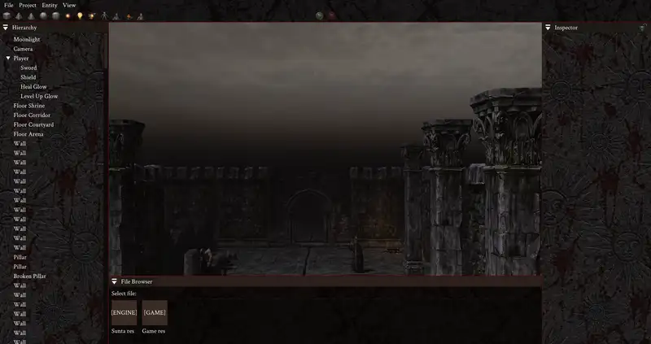

# Getting started

## Building the engine

On Windows: Visual Studio 2022 with "Desktop development with C++", then in **Developer PowerShell for VS 2022**:

```bat
git clone https://github.com/LightWeightBrah/Sunta-3D-Game-Engine.git
cd Sunta-3D-Game-Engine
cmake --preset x64-Release
cmake --build --preset x64-Release
bin\Release-Windows-AMD64\SuntaEditor.exe
```

Linux and macOS have their own presets (`linux-release`, `macos-release`), see the README's
[Building the Engine](https://github.com/LightWeightBrah/Sunta-3D-Game-Engine#building-the-engine).

## The project launcher

`SuntaEditor` starts with the launcher: create a project (a folder with `res/` inside: Scenes, Scripts, Models, ...)
or open one, e.g. one of the samples in `Projects/`. `SuntaEditor <project folder>` opens a project at once.

While the engine, a project or a game loads, the window shows a loading screen with the progress.

## The editor



- **Hierarchy** (left): the entities of the scene. Drag one onto another to make it its child (a sword on the hand
  bone of a character: see [Parent](components.md#parent)).
- **Inspector** (right): the components of the selected entity; **Add Component** adds more.
- **File Browser** (bottom): the engine's and the game's files (`[ENGINE]`, `[GAME]`); drag a model into the scene.
- **Console** (a tab next to the File Browser): the log of the engine and of the scripts' `print()`, by level,
  with a filter.
- The toolbar: primitives, lights, ready characters; **Play** / **Stop** in the middle.
- **Entity** menu: *Create Souls Player*, *Create Rusted Knight (enemy)*, *Create Bonfire*, *Create Camera From View*.
- **Project** menu: *Project Settings...* (the game's name, start scene, window, icon, **Save and Build Game**),
  *Collision Layers & Matrix...*, *Switch Project...*.
- **View** menu: camera speed, gizmos of colliders and weapon hitboxes, lock-on sight rays.

Keys of the editor: **Tab** switches between the editor and the game's own camera and controls while playing;
**Escape** while playing opens the game's pause menu (its *Quit* stops Play mode).

## The player's keys (every game made with the engine)

| Key | What it does |
|---|---|
| W A S D | walk (relative to the camera) |
| Shift | hold: run; tap: roll (backstep standing still) |
| Left mouse | light attack (pressed again during the attack: the next blow of the combo) |
| Ctrl + left mouse | heavy attack |
| Right mouse | block |
| F | parry |
| Space | jump (left mouse in the air: a jump attack; Ctrl + left mouse: a plunge into the ground) |
| Q | lock on to the nearest enemy in sight (again: let go) |
| R | drink from the healing flask |
| E | rest at a bonfire, go through a fog gate, skip a cutscene |
| A spell's key | cast it (each Spell Caster of the player has its own key, e.g. 1, 2, 3) |
| Escape | pause menu (Resume / Quit) |

## Building a game

**Project > Project Settings > Save and Build Game** puts a folder in the project's `Build/`: the game program and its
`res/`. Zip it and send it. A *Development build* (a checkbox there) shows a console with the log, reloads Lua
scripts when they are saved and lets **F1** make the player immortal while testing.

From a command line (no window): `SuntaEditor --build-game <project folder> [--development]`.
