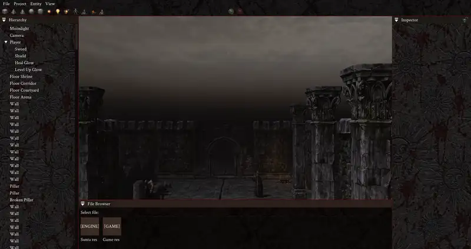
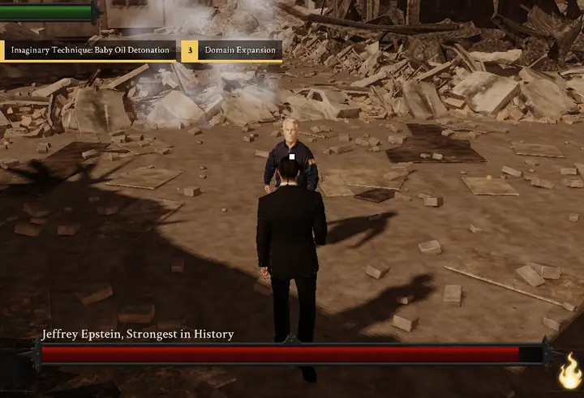

# Sunta Engine

A 3D game engine written in C++ and OpenGL for **souls-like** games: an editor, a game you build out of it, and ready
made parts for everything a souls-like needs - a player who rolls, blocks, parries and locks on, enemies that chase
and circle, bosses behind fog gates, bonfires, healing flasks, souls lost on death, spells, cutscenes and effects.

## Start here

| Page | What it is |
|---|---|
| [Getting started](getting-started.md) | Building the engine, the project launcher, the editor and its keys |
| [Tutorial: a small souls-like](tutorial-soulslike.md) | Step by step: an arena, a player, an enemy, a bonfire, a boss behind a fog gate, a built game |
| [Components](components.md) | Every component of the engine (generated from the engine's code) |
| [Scripting](scripting.md) | Lua scripts: how they are written, when they run, examples |
| [Scripting reference](scripting-reference.md) | Everything a script can reach (generated from the engine's bindings) |
| [Testing a game automatically](testing.md) | Input scripts, screenshots, the test bot, combat logs, background runs |

## Two sample games

- **MyGame** (`Projects/MyGame`) - a classic dark fantasy souls-like: a knight, ghouls, cultists, a boss arena.
- **Strongest in History Vs Today** (`Projects/StrongestInHistoryVsToday`) - a four-phase boss fight with domains,
  summons, transformations and cutscenes, built entirely from the engine's general parts and Lua scripts.

Both open in the editor from the project launcher; both are made the same way as the tutorial's game, only bigger.
